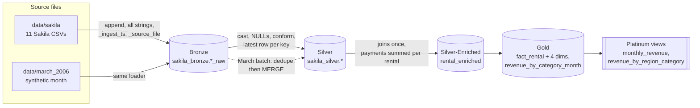
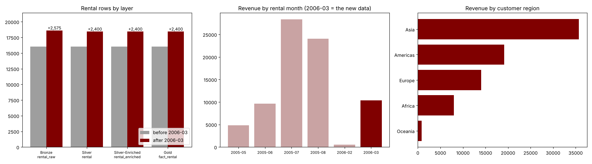

# Sakila lakehouse on Delta Lake (Databricks and local Spark)

[](https://github.com/ajace13/sakila-databricks-lakehouse/actions/workflows/ci.yml)

A batch medallion pipeline over the Sakila DVD-rental data. Raw CSVs land in Bronze. They're cleaned, typed and deduped in Silver, joined into one wide row per rental in Silver-Enriched, modelled as a star schema in Gold, and served as documented views in Platinum. A month later a new batch arrives and is applied with Delta `MERGE`. Delta's history and time travel then show exactly what changed, and a full rebuild from Bronze confirms the incremental result row for row.

I built it first on Databricks Free Edition. This repository is my rewrite: one module per layer, a synthetic month of new data, and a local Spark + Delta Lake run that CI executes end to end.

**Highlights**

- **Every layer has one job and one grain**, written at the top of its module: [bronze](src/lakehouse/bronze.py), [silver](src/lakehouse/silver.py), [enriched](src/lakehouse/enriched.py), [gold](src/lakehouse/gold.py) and [platinum](src/lakehouse/platinum.py).
- **The first MERGE fails on purpose, and the fix is explained.** The new batch sends some rentals twice, so Delta raises `DELTA_MULTIPLE_SOURCE_ROW_MATCHING_TARGET_ROW_IN_MERGE`. Deduping with Silver's own rule fixes it: 150 updated, 2,400 inserted. Full walkthrough: [docs/incremental_merge.md](docs/incremental_merge.md).
- **The incremental result is checked against a full rebuild.** Rebuilding Silver from all of Bronze and comparing it with the merged table using `EXCEPT` in both directions gives 0 and 0.
- **Silver-Enriched keeps one row per rental.** Payments are summed per rental before the join, and a grain check compares row counts and revenue after every load.
- **Two fixes to the original version:** re-running the Bronze load can no longer double the tables, and the dedupe tie-breaker uses the source's `last_update`, because `_ingest_ts` is identical for every row in one file.
- **The new month of data is mine and reproducible.** [A seeded generator](src/lakehouse/march_generator.py) writes 2,400 new rentals, 150 returns of open rentals, 25 re-sent rows and a country-to-region file. A test regenerates them and compares byte for byte.
- **15 tests** run the whole pipeline on Spark 4 and Delta Lake 4 in GitHub Actions. They check row counts at every layer, the failing and succeeding MERGEs, Delta history, time travel and revenue reconciliation.

## How it fits together



| Layer | One row is | What it adds |
|---|---|---|
| Bronze | one line of a source file | nothing: every value stays a string (even the literal `\N`), plus when it landed and from which file |
| Silver | one rental, payment, customer… | real types, exact decimals, real NULLs, Title Case names, lower-case emails, one row per key |
| Silver-Enriched | one rental, with everything about it | film, category, customer, city, country, region, amount paid, days out, late or not |
| Gold | one rental (fact); one customer, film, store or day (dims) | a star schema, plus revenue by category by month |
| Platinum | one point on a chart | views with a comment on every column, so a dashboard reads business rules instead of rebuilding them |

## Run it

**Locally** (Python 3.10+ and Java 17 or 21; the Delta jars download on first run):

```bash
git clone https://github.com/ajace13/sakila-databricks-lakehouse.git && cd sakila-databricks-lakehouse
pip install -r requirements.txt
PYTHONPATH=src python -m lakehouse --chart docs/images/local_run.png   # about a minute
pytest -v
```

Abridged output:

```
March batch: 2,575 rental rows, 2,550 distinct, 150 already in Silver
MERGE without dedupe: DELTA_MULTIPLE_SOURCE_ROW_MATCHING_TARGET_ROW_IN_MERGE
Rental merge after dedupe: 2,550 affected, 150 updated, 2,400 inserted
Payment merge after dedupe: 2,400 affected, 0 updated, 2,400 inserted

Time travel on sakila_silver.rental: version 0 had 16,044 rows, now 18,444; 2,550 new or changed; 150 rentals returned since
Rebuild from Bronze vs MERGE result: 0 rows only in the rebuild, 0 only in the merged table

Main table at each layer, before and after the month
  1 Bronze           sakila_bronze.rental_raw                    16,044  18,619  +2,575
  2 Silver           sakila_silver.rental                        16,044  18,444  +2,400
  3 Silver-Enriched  sakila_silver_enriched.rental_enriched      16,044  18,444  +2,400
  4 Gold             sakila_gold.fact_rental                     16,044  18,444  +2,400
  4 Gold             sakila_gold.dim_date                           267     312     +45
```

To recreate the March files: `PYTHONPATH=src python -m lakehouse.march_generator`.

**On Databricks:** add the repository as a Git folder, open [notebooks/lakehouse_on_databricks.py](notebooks/lakehouse_on_databricks.py), and follow its setup cell. It runs on the Free Edition with serverless compute.



## What I found

- **MERGE is all or nothing.** The failed MERGE leaves no version in `DESCRIBE HISTORY`, and the table is untouched. Only *matched* duplicates raise the error. Duplicated new rows would simply have been inserted twice, so deduping protects inserts as well.
- **Bronze being append-only is what makes the MERGE checkable.** Rebuilding Silver from all of Bronze gives exactly the table the MERGE produced.
- **The 9.95 that a rental table can't hold.** The original extract has 5 payments with no rental. Silver keeps them, because they're real money, but Silver-Enriched can't, so its revenue is 9.95 lower. The grain check makes that gap explicit instead of hiding it. Details: [docs/databricks_run.md](docs/databricks_run.md).
- **"100% of February rentals were late" is true, and misleading on its own.** The only February rentals ever returned came back weeks later in March. The Platinum view therefore also shows how many rentals that percentage is based on.
- **A column that's coming later should exist now.** `region` is in Silver-Enriched and `dim_customer` from the first load, NULL until the reference file arrives, so the schema doesn't change for whoever reads those tables.

## Databricks and local Spark

The same SQL runs on both, with two differences:

- **Dedupe syntax.** Databricks' `QUALIFY` isn't in open-source Spark, so the dedupe is written as `ROW_NUMBER()` in a subquery, which runs on both.
- **Default table format.** The local session makes Delta the default format, which Databricks already does.

The Databricks run used the original files. Its results, with the workspace user removed, are recorded in [docs/databricks_run.md](docs/databricks_run.md). The 2005 months match the local run to the cent.

## Repository layout

```
src/lakehouse/   one module per layer, plus incremental.py (the March MERGE), checks.py, the generator and the CLI
data/sakila/     the 11 Sakila CSVs the pipeline reads (Sakila 1.5)
data/march_2006/ the synthetic month, written by march_generator.py
notebooks/       the Databricks notebook that runs the same modules
tests/           generator tests, and a full pipeline run with checks at every layer
docs/            incremental_merge.md, databricks_run.md, charts
```

## Credits

Built for ADSP 31011 Cloud-Native Data Engineering at the University of Chicago, Autumn 2026. The course provided the original exercise and its March files; the code and the synthetic month here are my own. The Sakila sample database is © Oracle Corporation, distributed under the New BSD license; its CSVs are included in `data/sakila/` under that license ([LICENSE-SAKILA.txt](data/sakila/LICENSE-SAKILA.txt)). My own code is MIT licensed (see [LICENSE](LICENSE)).
