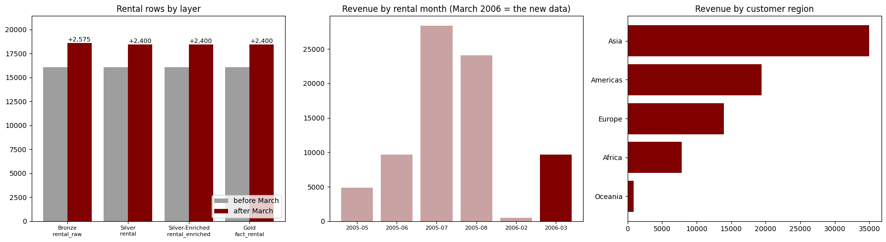

# The Databricks run

I first built this pipeline on Databricks Free Edition (serverless, Unity Catalog, catalog `workspace`) as an exercise, on 9 November 2026. That run used a provided Sakila CSV extract and March 2006 files, which aren't published here. This page records what that run produced, from its exported notebook. The workspace user name has been left out.

The code in this repository is my rewrite of that work. It runs locally on Spark and Delta Lake, and on Databricks through [notebooks/lakehouse_on_databricks.py](../notebooks/lakehouse_on_databricks.py). That notebook calls the same modules as the local run, but the rewritten version hasn't been run on Databricks yet.

## How the original data differs from the data here

The original extract has **16,049 payments totalling 67,416.51**, including 5 payments (9.95 in all) with no `rental_id`. The Sakila 1.5 CSVs in [data/sakila/](../data/sakila/) have **16,044 payments totalling 67,406.56**, with none missing a rental. Rentals and every rental-level number are identical in both. The [Cloud SQL project](https://github.com/ajace13/sakila-cloudsql-mysql) explains the same gap between those older numbers and the current Sakila download.

On Databricks, those 5 payments show up as the gap between Silver payment revenue (67,416.51) and Silver-Enriched revenue (67,406.56). A rental-level table can't hold a payment that has no rental. The grain check in [src/lakehouse/checks.py](../src/lakehouse/checks.py) reconciles the two by subtracting payments with no rental.

## Results

**Bronze and Silver, initial load:** rental 16,044 · payment 16,049 · customer 599 · film 1,000 · inventory 4,581 · category 16 · film_category 1,000 · store 2 · address 603 · city 600 · country 109.

**Getting to know the data (Silver):**
- Rentals by month: 2005-05 1,156 · 2005-06 2,311 · 2005-07 6,709 · 2005-08 5,686 · 2006-02 182.
- Most-rented film: BUCKET BROTHERHOOD, 34 rentals.
- Countries with the most customers: India 60, China 53, United States 36, Japan 31, Mexico 30.

**Silver-Enriched grain check:** 16,044 Silver rentals = 16,044 enriched rows. Revenue is 67,406.56 against 67,416.51 in payments; the 9.95 difference is the payments with no rental.

**Gold, top category-months by revenue:**

| month | category | rentals | revenue |
|---|---|---:|---:|
| 2005-07 | Sports | 497 | 2,281.03 |
| 2005-07 | Sci-Fi | 462 | 2,013.38 |
| 2005-07 | Drama | 463 | 1,978.37 |
| 2005-08 | Sports | 432 | 1,962.68 |
| 2005-07 | Animation | 489 | 1,954.11 |

**The March month:**
- Bronze grew by 2,575 rental rows (2,550 distinct) and 2,415 payment rows.
- The MERGE without dedupe failed with `DELTA_MULTIPLE_SOURCE_ROW_MATCHING_TARGET_ROW_IN_MERGE`.
- After dedupe, the rental MERGE affected 2,550 rows: 150 updated and 2,400 inserted. The payment MERGE inserted 2,400.

**Delta history of `sakila_silver.rental`:**

| version | operation | metrics |
|---:|---|---|
| 1 | MERGE | numSourceRows 2,550 · numTargetRowsInserted 2,400 · numTargetRowsUpdated 150 · executionTimeMs 3,172 |
| 0 | CREATE OR REPLACE TABLE AS SELECT | numOutputRows 16,044 |

**Time travel:** version 0 had 16,044 rows and the table now has 18,444; 2,550 rows are new or changed. 150 rentals that were open at version 0 are now returned (rental 11496 is the first, returned 7 March).

**Before and after at every layer:**

| layer | table | before | after | change |
|---|---|---:|---:|---:|
| Bronze | rental_raw | 16,044 | 18,619 | +2,575 |
| Bronze | payment_raw | 16,049 | 18,464 | +2,415 |
| Silver | rental | 16,044 | 18,444 | +2,400 |
| Silver | payment | 16,049 | 18,449 | +2,400 |
| Silver-Enriched | rental_enriched | 16,044 | 18,444 | +2,400 |
| Gold | fact_rental | 16,044 | 18,444 | +2,400 |
| Gold | dim_date | 267 | 312 | +45 |
| Gold | revenue_by_category_month | 80 | 96 | +16 |

After the month, Silver-Enriched held 18,444 rentals with revenue of 77,099.56, and none was missing a region.

**Platinum, `monthly_revenue`:**

| month | rentals | revenue | late % |
|---|---:|---:|---:|
| 2005-05 | 1,156 | 4,823.44 | 44.6 |
| 2005-06 | 2,311 | 9,629.89 | 45.9 |
| 2005-07 | 6,709 | 28,368.91 | 45.8 |
| 2005-08 | 5,686 | 24,070.14 | 46.1 |
| 2006-02 | 182 | 514.18 | 100.0 |
| 2006-03 | 2,400 | 9,693.00 | 48.5 |

**Platinum, revenue by region:** Asia 34,986.68 · Americas 19,413.69 · Europe 13,978.85 · Africa 7,857.33 · Oceania 863.01.

## Local run compared with this one

| | Databricks (original files) | Local (this repo) |
|---|---|---|
| 2005 months, rentals and revenue | as above | identical, to the cent |
| 2006-02 | 182 rentals, 514.18, 100% late | identical |
| March rentals and MERGE counts | 2,400 new, 150 updated, 25 duplicates | identical (the synthetic month has the same shape) |
| March revenue | 9,693.00 | 10,386.00 (synthetic amounts) |
| Regions | the original mapping | UN geoscheme mapping; same ranking, slightly different totals |
| Payments | 16,049 → 18,449 | 16,044 → 18,444 |
